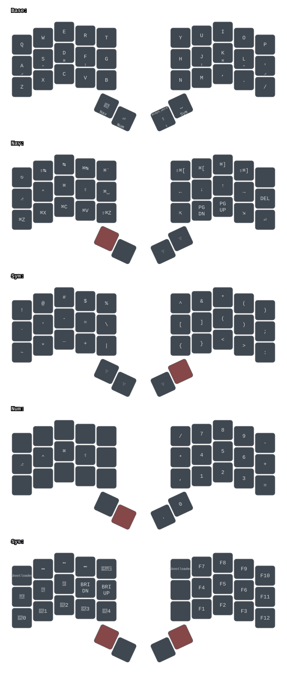

# mpa's zmk-config

[ZMK](https://github.com/zmkfirmware/zmk/) v0.3 configuration for Forager (34 keys),
Chocofi (36 keys), and Silakka54 Wireless (54 keys, nice!nano + nice!view).
Shared layers: Base, Nav, Sym, Num, Sys.

Modules:
- [zmk-tri-state](https://github.com/urob/zmk-tri-state): Cmd+Tab swapper.
- [zmk-rgbled-widget](https://github.com/caksoylar/zmk-rgbled-widget): Forager status LED.

## Builds

GitHub Actions uses [`build.yaml`](build.yaml). Download the `firmware` artifact.
Silakka54 files: `silakka54_left.uf2` and `silakka54_right.uf2`.

## Credits

Silakka54 Wireless uses adapted [ZMK/Lily58 shield code](https://github.com/zmkfirmware/zmk/tree/v0.3.0/app/boards/shields/lily58)
([MIT license](boards/shields/silakka54_wireless/LICENSE)) and the physical design of
[Silakka54 by Squalius-cephalus](https://github.com/Squalius-cephalus/silakka54).
The wireless PCB's author is unknown; this is not an official port.
